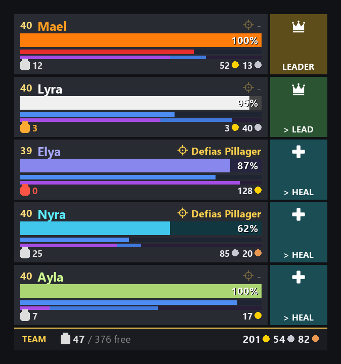
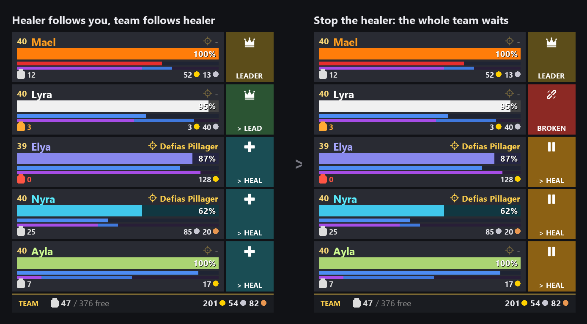
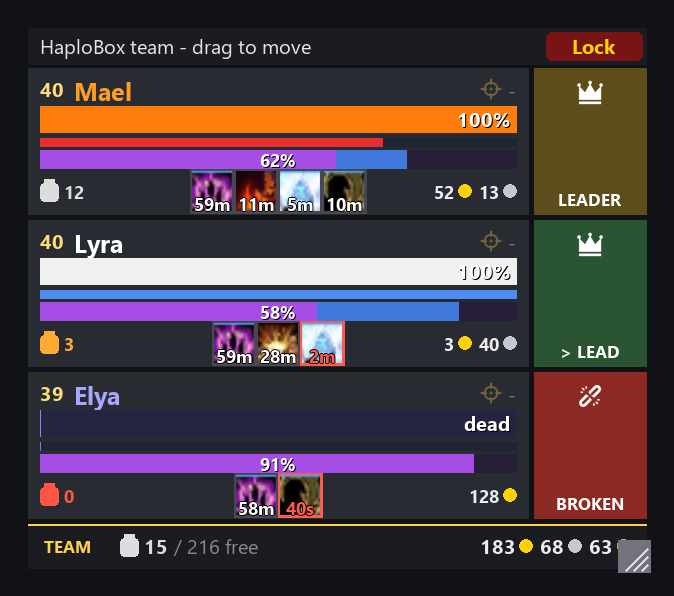

# HaploBox

**Run five characters like one.** HaploBox is a World of Warcraft addon for multiboxers. You see your whole team at a glance, you hear the moment someone falls behind, and the chores between pulls (invites, quest sharing, loot) happen on their own.



Built for **WoW Forever** (interface 16001). It also loads on Classic Era and retail.

---

## Why HaploBox?

Multiboxing goes wrong in small, silent ways. A follower snags on a fence post. The mage has no focus target. The warlock is out of range and nobody notices until the pull goes bad. HaploBox puts that information where you are already looking.

| | |
|---|---|
| **See the team** | One compact frame: health, power, XP, free bag slots, gold, focus target and follow status for every character. |
| **Hear problems** | A follower that stops following triggers a raid warning on the leader's screen. |
| **Never miss a whisper** | Character whispers to any follower show up on the leader, and you can answer from there. |
| **Skip the busywork** | Invites, quest sharing, free-for-all loot and role checks are handled automatically. |
| **Stay safe** | Only your own team can steer your characters, and forwarded whispers stay between the follower and the leader. HaploBox changes its secure frames only out of combat and avoids known taint paths. |

---

## The team frame

Each row is one character:

- **Level and name**, the name in its class colour.
- **Health bar** with a percentage, or `dead` / `offline`.
- **Power bar** in the right colour for mana, rage or energy.
- **XP bar** in purple with the percentage on it, and rested XP as a blue extension. Hidden at max level.
- **Free bag slots** (bottom left). Amber at 5 or fewer, red when the bags are full.
- **Buffs** (bottom middle) cast by your group, with the time left on each icon. Only buffs of a minute or longer, so procs, stances and food stay out. A buff with 2 minutes or less turns red. When there is no room, `+2` shows how many more there are.
- **Gold** (bottom right), kept short: `128g`, `52g 13s`, `85s 20c`.
- **Focus** (crosshair, top right): the target that character has on focus. A dash means no focus.
- **Status box** (right side): who that character is following.

The **TEAM** line at the bottom adds it all up: free bag slots and the gold of the whole team. When a character has not reported yet (an older HaploBox, not logged in, or not in the team list), its row shows a dash and the total says `3 of 5`.

On the leader, two team buttons appear below Blizzard's death, resurrection and corpse-recovery popup. They work even when the HaploBox team frame is hidden:

- **Release team** releases dead characters to the graveyard; living characters and ghosts are skipped.
- **Rezz team** accepts an available resurrection or reclaims a ghost's corpse when it is in range and the recovery timer has expired. It does not cast a resurrection spell or accept spirit-healer penalties. If a character is not ready, click again when it is.

Install the updated addon on every character. Followers accept these commands only from their stored team leader.

Click a row to target that character. `[@mouseover]` macros work on the rows, so your healer can heal straight from the frame. Characters out of range fade.

The health bars can show more, all read from the game itself and each with its own setting under **Team frame**:

- **Incoming heals:** a lighter part of the health bar shows heals on their way, on clients that report them. When the game hides the numbers, nothing extra is shown.
- **Casts:** a thin yellow bar along the bottom of the health bar fills while a character casts; a green one empties while it channels. It disappears when the cast ends, fails or is interrupted.
- **Five-second rule** (Classic Era only): after a character's mana goes down, a thin light bar on top of its mana bar runs down for five seconds. It is an estimate of the pause in spirit-based regeneration after spending mana: HaploBox sees only that mana went down, so a mana drain by an enemy starts it too. Free spells do not. On other clients it is not shown, because the rule is not known to apply there.
- **Heals over time:** small icons at the bottom left of the health bar show HoTs from your group with their seconds left: Renew, Rejuvenation, Regrowth, Lifebloom, Wild Growth and Riptide, or the spells you list under **Heal-over-time spells**.
- **Required buffs:** list the buffs everyone should have under **Buffs everyone should have** (for example `Power Word: Fortitude, Arcane Intellect`). A row then names the missing ones in red, or shows `buffs ?` when the game does not tell.
- **Buff and debuff windows:** two optional windows (off by default) list every member's buffs or debuffs with timers, debuffs bordered by their dispel type. Drag them by the title while the team frame is unlocked; they keep their place. Clicks pass through the icons.

When the game restricts aura data (retail does this in combat), or a member is offline, these show `unknown` (or `offline`) instead of old or guessed values. HaploBox reads up to 40 auras per member; if there are more, a buff it did not reach shows as `buffs ?`, not as missing, and the window marks the list with `?`. They are additions: Blizzard's own frames are not changed.

**Mini Heal view:** for small follower windows, switch the frame to Mini Heal (quick settings, **Team frame > View**, `/hb frame mini`, or a key binding you set under Keybindings > AddOns > HaploBox; no key is assigned for you). Each member becomes one big health tile with the name and percent inside; incoming heals, casts and HoTs still show. They are the same rows, so clicking and `[@mouseover]` work the same. The choice and its size are kept for this WoW account only and are never sent to the team. `/hb frame main` switches back. Switching in combat happens when combat ends.

**Sharing the layout:** set the frame up once on the leader, then click **Share this layout with the team** (settings, **Team frame**) or type `/hb frame share`. A popup names who gets it and what is shared: what the frame shows, its size, scale and position (as a fraction of the screen, so it fits other window sizes) and the aura windows. Not shared: Main / Mini Heal, team and roles, automation, sounds and key bindings. It goes by private addon whisper to team members in your group, and the leader sees per character whether it was applied, waits for the end of combat, was refused, or got no answer (older HaploBox, offline). A follower takes it only from its own leader, can turn **Take the layout the leader shares** off, and can put its own layout back with **Undo the shared layout** or `/hb frame undo`.

WoW does not let addons rebind the rows in combat. If someone joins or leaves the group in combat, a row that now points at a different character turns dim and shows `?` until combat ends. Do not click it until then.

### Status box

| Box | Meaning |
|---|---|
| Gold, crown, **LEADER** | This is the leader. |
| Green, crown, **> LEAD** | Following the leader. |
| Teal, cross, **> HEAL** | Following the healer. |
| Teal, link, **> NAME** | Following another character. |
| Red, broken link, **BROKEN** | Not following anyone. |
| Amber, pause, **> NAME** | Still following, but someone further up the chain has stopped. |
| Grey, **AWAY** | In the team, but not in your group. |

### The follow chain

Plenty of multiboxers let only the healer follow the leader and have everyone else follow the healer. Then one keypress on the healer stops (or restarts) the whole team. HaploBox understands this setup. When you stop the healer, the healer turns red and everyone behind it turns amber, so you can see that the team is waiting and who to restart.



### Move, resize and lock

The frame starts unlocked. Drag the bar on top (or any row) to move it, and drag the corner to resize it. Click **Lock** when you are happy with it. The gear next to **Lock** opens quick settings for the frame (what it shows, scale, lock) with a link to the full settings. While the frame is locked, a small gear stays above its top-right corner; right-clicking the **TEAM** line or typing `/hb quick` opens them too. Changes made in combat apply when combat ends. While it is unlocked, the bar also has a **Send team** button: it makes the current group the team and sends it to every character, like `/hb team`. To move it again later, type `/hb frame unlock`.



By default the frame shows on the leader only. Any other character can show it too: `/hb frame show` on that character. Your healer is the obvious candidate.

---

## Never lose a follower

When a follower stops following, the leader gets a raid warning and a sound. Only the leader sees it, and nothing is posted in group chat.


Followers also send their cast errors (out of range, no line of sight, out of mana, target not in front) to the leader's chat, so you know why the mage is not casting. And when a follower's bags fill up, the leader gets a message.

---

## Never miss a whisper

Someone whispers your warlock while you play the druid. HaploBox puts the whisper in the leader's chat, with the name of the character that got it. This covers character whispers; Battle.net whispers are not forwarded.

```
[Haplina Darkheart] Bob whispers: are you selling that cloth?
```

Answer in one of two ways:

- `/hb r sure, 2g a stack` sends the reply through the character that got the last whisper.
- Or whisper that character directly (`/w Haplina Darkheart sure, 2g a stack`). For 5 minutes after Bob's last whisper, it passes your whispers on to Bob. Replying does not extend that time; after it, use `/hb r`.

You get a confirmation: `reply passed to Haplina Darkheart for Bob`. The game does not confirm that a whisper arrived. When the game reports within a second that Bob is offline, you get `Haplina Darkheart could not whisper Bob` instead; a missing warning does not prove the whisper arrived. Whispers between your own characters are never forwarded, and GM whispers are marked `<GM>`.

Forwarded whispers and replies go privately between the follower and the leader, never to the rest of the group. This needs HaploBox 0.9.0 or later on every character: older versions still send them over the group channel. Turn off **Pass the leader's replies on** on a character, and it relays neither `/hb r` replies nor direct whispers.

---

## Automation

- **Invites:** followers accept group invites from the leader.
- **Quests:** when the leader accepts a quest, it is shared with the group and the followers accept it. Followers accept shared quests only from your team, not from other players in the group. A failed share plays a sound and tells you why. Prefer every character to share? Set **Share quests I accept** to `always` in the settings, under **Quests & travel**.
- **Loot:** when the group changes, the leader sets free-for-all loot if everyone in the group is on the team. If someone from outside the team is in the group, free for all becomes group loot. HaploBox also waits while a member's name still shows as Unknown. A loot method you pick yourself, in Blizzard's menu or with `/hb ffa`, is never overwritten: it stays until you leave the group or a new team-only group forms. `/hb ffa` with outsiders in the group works, with a warning. HaploBox reads the method back and tells you if the change did not take. WoW Forever has no `/ffa` command.
- **Roles:** each character sets its own party role (tank, healer or damage) and its group finder roles from its team role, answers role polls and answers group finder role checks.
- **Quest tracker:** Blizzard's quest tracker is hidden, which keeps five screens tidy. Turn it back on with `/hb tracker` or in the settings.
- **Flights:** when the leader takes a flight, each follower flies to the same place as soon as it opens its own flight map (within 2 minutes). Followers that do not know that flight path get a message instead.
- **Optional:** followers leave the group when the leader leaves.

The settings are under **Options > AddOns > HaploBox** (or type `/hb options`), in sections: Team & roles, Team frame, Follow & alerts, Group & loot, Quests & travel, Whispers, Sounds and Advanced. `/hb options frame` opens a section directly. Settings are saved per WoW account (in a multibox setup, each character has its own) and are never sent to the team; a grey note says when a setting only does something on the leader or on followers. **Make this character the leader** is kept apart, because it sends the team to the group.

---

## Quick start

1. **Install** HaploBox on every account (see [Install](#install)).
2. **Group up** with your team.
3. On the **leader**, open the settings (**Options > AddOns > HaploBox**) and click **Make this character the leader** under Team & roles. The current group becomes your team and is sent to every character. (Or type `/hb team`.)
4. Each follower shows a popup: **Haplo wants to lead your team**. Click **Accept** on each one (one click if you mirror clicks to all windows). A character only takes a team from the leader it already knows, so nobody else in your group can take over your characters. (Or type `/hb accept`, or use the key binding.)
5. On each character, pick its role in the same panel: **tank**, **healer** or **dps**. The toon with the healer role is the one followers can follow. (Or type `/hb role healer`.)

Group members who are not on the team yet are named in a confirmation popup first. Add only your own characters: team members are trusted with team messages. If the group changes before you click, nothing is added and you press the button again.

That's all. The leader alert, the team frame and the automation now know who is who. Swapped a character? Group the new team and click **Make this character the leader** (or **Send team** on the frame, or `/hb team`) again; followers that already know the leader take it without a popup. Changed the leader? Each follower accepts the popup once.

> Using the `multibox-team-setup` skill? It writes the team for you, along with macros, keybindings and settings, so you can skip steps 3 to 5.

---

## Commands

`/hb` and `/haplobox` both work. Type `/hb` alone for help in game.

**Team**

| Command | What it does |
|---|---|
| `/hb team` | On the leader, in a party: make this group the team and send it to every character. |
| `/hb team show` | List the team, the leader and the roles. |
| `/hb role tank\|healer\|dps` | Set your role (also in the options panel). It is sent to the group. |
| `/hb leader [name]` | Set the leader by hand (no name: your target). |
| `/hb accept` | Accept the team that a new leader sent. |
| `/hb status` | Show the leader, your role and the loot method. |

**Team frame**

| Command | What it does |
|---|---|
| `/hb frame auto\|show\|hide` | Show the frame on this character: `auto` = only on the leader. |
| `/hb frame lock\|unlock` | Lock it in place, or unlock it to move and resize. |
| `/hb frame colors` | Turn class colours on or off. |
| `/hb frame xp\|gold\|bags\|buffs` | Show or hide level and XP, gold, free bag slots, or buffs. |
| `/hb frame scale 0.8` | Scale the whole frame (0.5 to 2). |
| `/hb frame solo` | Also show the frame when you are not in a group. |
| `/hb frame reset` | Put the frame back to its starting position and size. |

**Everything else**

| Command | What it does |
|---|---|
| `/hb r <text>` | Leader: reply to the last forwarded whisper. |
| `/hb ffa` | Set free-for-all loot (group leader only). Warns when someone outside the team is in the group. |
| `/hb share` | Share every quest in your log with the group. |
| `/hb tracker` | Hide or show Blizzard's quest tracker (hidden by default). |
| `/hb sound <event> <value\|off>` | Change a sound. |
| `/hb test alert` / `/hb test <event>` | Try the leader alert or a sound. |
| `/hb who` | Show how the game names you and your target. |
| `/hb options [section]` | Open the settings, optionally at a section: team, frame, follow, group, quests, whispers, sounds, advanced. |
| `/hb quick` | Open the team frame quick settings. |
| `/hb debug` | Toggle debug output. |

---

## Key bindings

Prefer keys to typing? Bind them under **Esc > Options > Keybindings > AddOns > HaploBox**. If you send key presses to all characters at once, one press sets up the whole team.

| Binding | What it does |
|---|---|
| Make this toon the leader and send the team | Same as the options button or `/hb team`. |
| Accept the team offered by a new leader | Same as **Accept** in the popup or `/hb accept`. |
| Make my target the leader | Same as `/hb leader` with the leader targeted. |
| My role: tank / healer / dps | Same as the role buttons or `/hb role`. |

---

## Make it sound right

Every sound can be changed or switched off in the options panel or with `/hb sound`.

| Event | When it plays |
|---|---|
| `leaderAlert` | Leader: a follower stopped following. |
| `followOn` / `followOff` | This character started or stopped following. |
| `shareError` | A quest share failed. |
| `inviteAccept` | An invite from the leader was accepted. |
| `whisperIn` | Leader: a forwarded whisper came in. |
| `bagsFull` | Leader: a character's bags are full (off by default). |
| `mountOn` / `mountOff` | Passenger mount on or off (off by default). |

A sound value can be:

- a SOUNDKIT name, such as `RAID_WARNING` or `READY_CHECK`;
- a sound kit id, such as `8959`;
- `file:<fileID>`;
- a file path such as `Interface\AddOns\HaploBox\Sounds\stop.ogg`. Put your own `.ogg` or `.mp3` files in the `Sounds` folder.

Example: `/hb sound leaderAlert READY_CHECK`.

---

## Install

Copy the `HaploBox` folder into `World of Warcraft\_forever_\Interface\AddOns\` on every computer you play from, then restart the game.

For development, link the folder to this repository instead:

```
mklink /J "C:\Program Files (x86)\World of Warcraft\_forever_\Interface\AddOns\HaploBox" "D:\Repos\HaploBox"
```

`/reload` picks up Lua changes. New files (textures, sounds) need a game restart.

To check changes outside the game, run `python tests/run.py` (needs `pip install lupa`). It compiles every Lua file under Lua 5.1 and runs the behaviour tests in `tests/` against stubbed WoW APIs.

---

## Under the hood

- **Communication:** every character talks over a hidden addon channel (`HaploBox`) in party or raid. Nothing appears in chat. Messages wait in a short queue so that a whole team logging in at once stays under the game's limit for addon messages.
- **Trust:** a character takes a team only from the leader it already has, or after `/hb accept`. Invites, flights and reply relays come only from that leader, and follow, focus, stats and error reports count only from team members.
- **Each character reports itself:** follow state, follow target, focus, level, XP, gold and bag space are sent when they change (stats at most once a second), and again when someone joins or logs in. The game only gives these numbers for your own character, so every character needs HaploBox, ideally the same version.
- **Whispers:** a follower forwards a whisper to the leader as a private addon whisper, not to the group. Long whispers are split into parts and joined again on the leader. If the game hides a whisper's text from addons, the leader still sees who whispered.
- **Secret values:** newer clients can hide health values from addons. HaploBox only passes them to status bars and text, never to its own calculations, so it keeps working where other frames throw errors.
- **Combat:** the rows are secure unit buttons. WoW does not allow them to be moved, resized or rebuilt in combat, so those changes wait until combat ends.
- **Settings:** stored per account in `HaploBoxDB`. The team (leader, roles, order) is stored in `HaploBoxTeam`.

---

## Credits

- **JCDR**: the visual concepts for the team frame (layout, status box, focus display), plus brainstorming and many of the ideas behind HaploBox.
