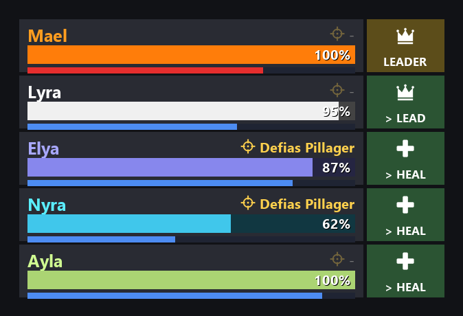
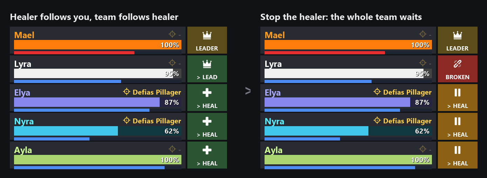
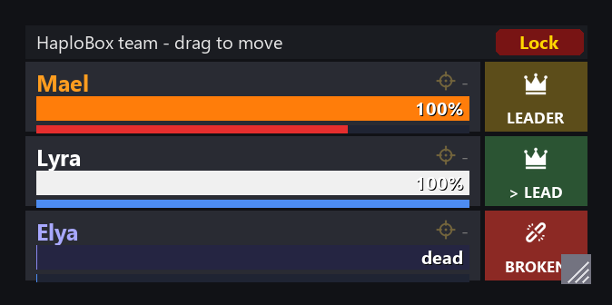

# HaploBox

**Run five characters like one.** HaploBox is a World of Warcraft addon for multiboxers. You see your whole team at a glance, you hear the moment someone falls behind, and the chores between pulls (invites, quest sharing, loot) happen on their own.



Built for **WoW Forever** (interface 16001). It also loads on Classic Era and retail.

---

## Why HaploBox?

Multiboxing goes wrong in small, silent ways. A follower snags on a fence post. The mage has no focus target. The warlock is out of range and nobody notices until the pull goes bad. HaploBox puts that information where you are already looking.

| | |
|---|---|
| **See the team** | One compact frame: health, power, focus target and follow status for every character. |
| **Hear problems** | A follower that stops following triggers a raid warning on the leader's screen. |
| **Skip the busywork** | Invites, quest sharing, free-for-all loot and role checks are handled automatically. |
| **Stay safe** | No protected or Edit Mode frames are touched, so the addon cannot taint your UI. |

---

## The team frame

Each row is one character:

- **Name** in its class colour.
- **Health bar** with a percentage, or `dead` / `offline`.
- **Power bar** in the right colour for mana, rage or energy.
- **Focus** (crosshair, top right): the target that character has on focus. A dash means no focus.
- **Status box** (right side): who that character is following.

Click a row to target that character. `[@mouseover]` macros work on the rows, so your healer can heal straight from the frame. Characters out of range fade.

### Status box

| Box | Meaning |
|---|---|
| Gold, crown, **LEADER** | This is the leader. |
| Green, crown, **> LEAD** | Following the leader. |
| Green, cross, **> HEAL** | Following the healer. |
| Green, link, **> NAME** | Following another character. |
| Red, broken link, **BROKEN** | Not following anyone. |
| Amber, pause, **> NAME** | Still following, but someone further up the chain has stopped. |
| Grey, **AWAY** | In the team, but not in your group. |

### The follow chain

Plenty of multiboxers let only the healer follow the leader and have everyone else follow the healer. Then one keypress on the healer stops (or restarts) the whole team. HaploBox understands this setup. When you stop the healer, the healer turns red and everyone behind it turns amber, so you can see that the team is waiting and who to restart.



### Move, resize and lock

The frame starts unlocked. Drag the bar on top (or any row) to move it, and drag the corner to resize it. Click **Lock** when you are happy with it. To move it again later, type `/hb frame unlock`.



By default the frame shows on the leader only. Any other character can show it too: `/hb frame show` on that character. Your healer is the obvious candidate.

---

## Never lose a follower

When a follower stops following, the leader gets a raid warning and a sound. Only the leader sees it, and nothing is posted in group chat.


Followers also send their cast errors (out of range, no line of sight, out of mana, target not in front) to the leader's chat, so you know why the mage is not casting.

---

## Automation

- **Invites:** followers accept group invites from the leader.
- **Quests:** when the leader accepts a quest, it is shared with the group and the followers accept it. A failed share plays a sound and tells you why. Prefer every character to share? Set **Share quests I accept** to `all` in the options panel.
- **Loot:** the leader sets free-for-all loot when someone joins, or on demand with `/hb ffa`. WoW Forever has no `/ffa` command.
- **Role checks:** group finder role checks are answered with each character's team role.
- **Optional:** followers leave the group when the leader leaves.

Each feature has its own checkbox under **Options > AddOns > HaploBox** (or type `/hb options`).

---

## Quick start

1. **Install** HaploBox on every account (see [Install](#install)).
2. **Group up** with your team.
3. On the **leader**, type `/hb team`. The current group becomes your team and is sent to every character.
4. On the **healer**, type `/hb role healer`.

That's all. The leader alert, the team frame and the automation now know who is who. Swapped a character? Group the new team and run `/hb team` again.

> Using the `multibox-team-setup` skill? It writes the team for you, along with macros, keybindings and settings, so you can skip steps 3 and 4.

---

## Commands

`/hb` and `/haplobox` both work. Type `/hb` alone for help in game.

**Team**

| Command | What it does |
|---|---|
| `/hb team` | On the leader, in a party: make this group the team and send it to every character. |
| `/hb team show` | List the team, the leader and the roles. |
| `/hb role tank\|healer\|dps` | Set your role. It is sent to the group. |
| `/hb leader [name]` | Set the leader by hand (no name: your target). |
| `/hb status` | Show the leader, your role and the loot method. |

**Team frame**

| Command | What it does |
|---|---|
| `/hb frame auto\|show\|hide` | Show the frame on this character: `auto` = only on the leader. |
| `/hb frame lock\|unlock` | Lock it in place, or unlock it to move and resize. |
| `/hb frame colors` | Turn class colours on or off. |
| `/hb frame scale 0.8` | Scale the whole frame (0.5 to 2). |
| `/hb frame solo` | Also show the frame when you are not in a group. |
| `/hb frame reset` | Put the frame back to its starting position and size. |

**Everything else**

| Command | What it does |
|---|---|
| `/hb ffa` | Set free-for-all loot (group leader only). |
| `/hb share` | Share every quest in your log with the group. |
| `/hb sound <event> <value\|off>` | Change a sound. |
| `/hb test alert` / `/hb test <event>` | Try the leader alert or a sound. |
| `/hb who` | Show how the game names you and your target. |
| `/hb options` | Open the options panel. |
| `/hb debug` | Toggle debug output. |

---

## Make it sound right

Every sound can be changed or switched off in the options panel or with `/hb sound`.

| Event | When it plays |
|---|---|
| `leaderAlert` | Leader: a follower stopped following. |
| `followOn` / `followOff` | This character started or stopped following. |
| `shareError` | A quest share failed. |
| `inviteAccept` | An invite from the leader was accepted. |
| `mountOn` / `mountOff` | Passenger mount on or off (off by default). |

A sound value can be:

- a SOUNDKIT name, such as `RAID_WARNING` or `READY_CHECK`;
- a sound kit id, such as `8959`;
- `file:<fileID>`;
- a file path such as `Interface\AddOns\HaploBox\Sounds\stop.ogg`. Put your own `.ogg` or `.mp3` files in the `Sounds` folder.

Example: `/hb sound leaderAlert READY_CHECK`.

---

## Install

Copy the `HaploBox` folder into `World of Warcraft\_forever_\Interface\AddOns\` on every computer you play from, then restart the game.

For development, link the folder to this repository instead:

```
mklink /J "C:\Program Files (x86)\World of Warcraft\_forever_\Interface\AddOns\HaploBox" "D:\Repos\HaploBox"
```

`/reload` picks up Lua changes. New files (textures, sounds) need a game restart.

---

## Under the hood

- **Communication:** every character talks over a hidden addon channel (`HaploBox`) in party or raid. Nothing appears in chat.
- **Each character reports itself:** follow state, follow target and focus are sent when they change, and again when someone joins or logs in. Every character needs HaploBox, ideally the same version.
- **Secret values:** newer clients can hide health values from addons. HaploBox only passes them to status bars and text, never to its own calculations, so it keeps working where other frames throw errors.
- **Combat:** the rows are secure unit buttons. WoW does not allow them to be moved, resized or rebuilt in combat, so those changes wait until combat ends.
- **Settings:** stored per account in `HaploBoxDB`. The team (leader, roles, order) is stored in `HaploBoxTeam`.
